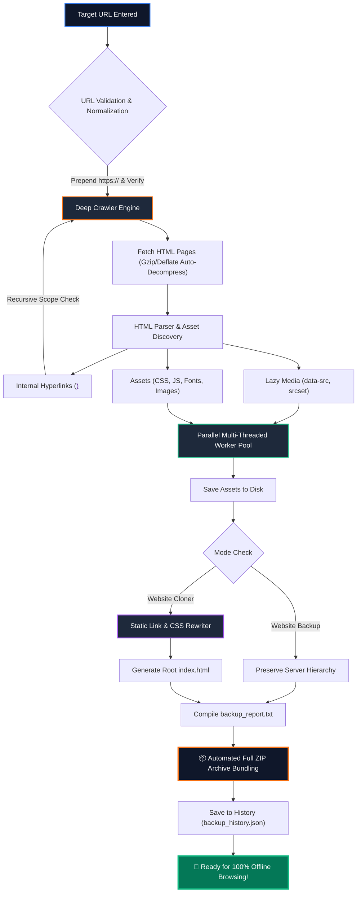

<div align="center">


<br/>

# 🌐 SCITBOSS WEBSITE BACKUP & CLONER PRO
### *Production-Grade Windows Desktop Static Website Downloader, Deep Mirroring Engine & Automated Full ZIP Packager*

<br/>

[](#)
[](https://www.python.org/)
[](https://microsoft.com/windows)
[](https://docs.python.org/3/library/tkinter.html)
[](#)
[](https://github.com/scitboss)

<br/>

[🚀 Quick Start](#-quick-start) •
[✨ Key Features](#-key-features) •
[🧠 How It Works](#-how-it-works) •
[📦 Executable (.exe)](#-windows-standalone-executable-exe) •
[⚙️ Configuration](#-configuration--settings-guide) •
[🛡️ Responsible Use](#️-security--responsible-use-policy) •
[👤 Developer Credit](#-developer-credit)

---

</div>

## 🌟 Executive Summary

**SCITBOSS WEBSITE BACKUP & CLONER PRO** is an advanced, commercial-grade Windows desktop application engineered for deep crawling, static website cloning, local offline preservation, and **automated full ZIP archive bundling**.

Built entirely in a **single self-contained Python file** using Python's standard libraries and native Tkinter, it runs out of the box with **ZERO external pip module dependencies**. It includes high-speed multi-threaded asset downloading, automatic Gzip/Deflate HTTP decompression, lazy-loaded media detection, and complete relative link rewriting for 100% offline browsing.

---

## ✨ Key Features

<table>
  <tr>
    <td width="50%">
      <h3>📦 Automated Full ZIP Packaging</h3>
      <p>Every backup or cloning operation automatically compiles the entire downloaded website into a compressed, ready-to-share <code>.zip</code> archive. Includes one-click <b>"Open ZIP"</b> shortcuts in the Dashboard and History panels.</p>
    </td>
    <td width="50%">
      <h3>⚡ Unlimited Deep Crawling Engine</h3>
      <p>No artificial page limits. Equipped with an <b>Unlimited Crawling Mode</b> that recursively navigates internal hyperlinks until every discovered page and resource on the domain is fully mirrored.</p>
    </td>
  </tr>
  <tr>
    <td width="50%">
      <h3>🖼️ Lazy-Loaded Media & All File Types</h3>
      <p>Specialized handling for modern frameworks (WordPress, Shopify, Webflow, React). Detects <code>data-src</code>, <code>data-srcset</code>, <code>data-original</code>, and <code>data-bg</code>, converting them into direct static offline images.</p>
    </td>
    <td width="50%">
      <h3>🚀 Multi-Threaded Parallel Downloader</h3>
      <p>Powered by <code>concurrent.futures.ThreadPoolExecutor</code>. Downloads dozens of images, stylesheets, scripts, and webfonts concurrently, accelerating download speeds up to <b>10x</b>.</p>
    </td>
  </tr>
  <tr>
    <td width="50%">
      <h3>🔄 100% Offline Static Site Rewriting</h3>
      <p>Transforms absolute and remote references into local relative paths in all HTML files and CSS stylesheets. Double-clicking the generated <code>index.html</code> opens the entire site offline in any web browser.</p>
    </td>
    <td width="50%">
      <h3>🎨 Modern Dark Theme Windows GUI</h3>
      <p>Features an ultra-sleek dark interface with native Windows 10/11 DWM dark title bars, High-DPI screen awareness, real-time KPI metric cards, and a live color-coded activity terminal.</p>
    </td>
  </tr>
</table>

---

## 📊 Mode Comparison: Backup vs. Cloner

| Capability | 💾 Website Backup Mode | ⚡ Website Cloner Mode |
| :--- | :---: | :---: |
| **Download HTML Web Pages** | ✅ Yes | ✅ Yes |
| **Download CSS, JS & Media Assets** | ✅ Yes | ✅ Yes |
| **Preserve Original Remote Server Structure** | ✅ Exact Mirror | ✅ Sanitized Offline Structure |
| **Rewrite Hyperlinks (`<a href>`) to Local HTML** | ❌ Raw URLs Kept | ✅ Rewritten to Local `.html` |
| **Rewrite CSS `url(...)` & `@import` to Assets** | ❌ Raw URLs Kept | ✅ Rewritten to Local Assets |
| **Mirror External CDNs (Google Fonts, cdnjs)** | ❌ Skipped | ✅ Saved into `assets/external/` |
| **Fix Lazy Images (`data-src` -> `src`)** | ❌ As-is | ✅ Converted for Offline Viewing |
| **Generate Root `index.html` Launcher** | ❌ Only if at root | ✅ Always Guaranteed |
| **Automated Full ZIP Archive (.zip)** | ✅ Included | ✅ Included |
| **Comprehensive `backup_report.txt`** | ✅ Generated | ✅ Generated |

---

## 🧠 How It Works



---

## 📁 Generated Output Directory & ZIP Archive Structure

When a backup or clone completes, the output directory and ZIP file are structured cleanly:

```
SCITBOSS_Backups/
│
├── Clone_example_com_20261124_221130/          <-- Unpacked Website Folder
│   ├── index.html                              <-- Double-click to browse offline!
│   ├── about.html
│   ├── contact.html
│   ├── assets/
│   │   ├── css/
│   │   │   ├── main.css
│   │   │   └── fonts.css
│   │   ├── js/
│   │   │   ├── app.bundle.js
│   │   │   └── vendor.min.js
│   │   ├── images/
│   │   │   ├── hero.webp
│   │   │   ├── logo.svg
│   │   │   └── banner.jpg
│   │   ├── fonts/
│   │   │   ├── inter-bold.woff2
│   │   │   └── roboto.woff2
│   │   └── external/                           <-- Mirrored external CDNs
│   │       ├── cdnjs.cloudflare.com/
│   │       └── fonts.googleapis.com/
│   └── backup_report.txt                       <-- Detailed execution audit
│
└── Clone_example_com_20261124_221130_FULL.zip  <-- 📦 Complete Compressed ZIP Archive
```

---

## 🚀 Quick Start


---

### Option 1: Run from Python Source Code
Requires Python 3.8+ on Windows:
```powershell
# Clone or download this repository
git clone https://github.com/scitboss/WEBSITE-BACKUP-CLONER-PRO.git
cd WEBSITE-BACKUP-CLONER-PRO

# Run the single-file application directly
python WEBSITE-BACKUP-CLONER-PRO.py
```


---


---

## 🖥️ Application Interface Tour

<div align="center">

| Navigation Panel | Features & Controls |
| :--- | :--- |
| **📊 Dashboard** | Real-time KPI cards (Pages Scanned, Files Downloaded, Size, Speed), progress percentage, live color-coded activity terminal, and quick-action buttons (`Open ZIP`, `Open Folder`, `Export Log`). |
| **💾 Website Backup** | Full server folder structure preservation, asset toggles (Images, CSS, JS, Fonts, Docs, Media), directory tree preview, and backup execution controls. |
| **⚡ Website Cloner** | Static offline mirroring with relative hyperlink rewriting, lazy image conversion, external CDN mirroring, and direct `Open Cloned Site in Browser` button. |
| **🕒 Backup History** | Persistent local JSON history tracking previous projects with one-click actions: `Open ZIP`, `Open Folder`, `Launch Website`, `View Report`, and `Delete Entry`. |
| **⚙️ Settings** | Performance sliders (Max Pages, Crawl Depth, Parallel Threads, Delay, Timeout, File Size), scope options (Unlimited Crawl, Subdomains, SSL Bypass), and default storage selector. |
| **ℹ️ About Software** | Developer credentials, GitHub links, PyInstaller compile tools, and responsible use policies. |

</div>

---

## ⚙️ Configuration & Settings Guide

The application stores user preferences locally in `~/.scitboss_backup_cloner/config.json`:

| Setting Key | Default Value | Description |
| :--- | :---: | :--- |
| `unlimited_crawl` | `False` | When enabled, removes page limits and crawls every discovered page on the domain. |
| `max_pages` | `500` | Maximum number of HTML pages to discover and download. |
| `max_depth` | `8` | Maximum recursion crawl depth from the root URL. |
| `thread_workers` | `6` | Number of concurrent worker threads for parallel asset downloading. |
| `auto_create_zip` | `True` | Automatically compiles the complete website into a `.zip` archive upon completion. |
| `request_delay` | `0.05s` | Politeness delay between HTTP requests to avoid rate-limiting. |
| `timeout` | `20s` | Connection timeout threshold in seconds. |
| `max_file_size_mb` | `150 MB` | Skips oversized single files exceeding this threshold to protect disk space. |
| `download_images` | `True` | Downloads PNG, JPG, JPEG, WebP, SVG, GIF, ICO, AVIF, TIFF. |
| `download_css` | `True` | Downloads CSS stylesheets, parses inline styles, and fetches embedded fonts. |
| `download_js` | `True` | Downloads JavaScript files, bundles, modules, and scripts. |
| `download_fonts` | `True` | Downloads WebFonts (WOFF, WOFF2, TTF, OTF, EOT). |
| `download_docs` | `True` | Downloads publicly linked documents (PDF, DOCX, TXT, CSV). |
| `download_media` | `True` | Downloads public audio and video files (MP4, MP3, WebM, WAV). |
| `ignore_ssl_errors`| `True` | Bypasses SSL certificate errors for self-signed, test, or legacy sites. |
| `respect_robots_txt`| `False` | When disabled, allows comprehensive full-site archiving without robot exclusions. |

---

## 🛡️ Security & Responsible Use Policy

**SCITBOSS WEBSITE BACKUP & CLONER PRO** is developed strictly for:
- Personal website backups and data ownership preservation.
- Authorized website migration and static archiving.
- Public web preservation and offline reference.
- Educational web architecture analysis and offline design inspection.

> [!IMPORTANT]
> **Strict Security Boundaries:**
> - The application operates exclusively through standard public HTTP/HTTPS client requests.
> - It **does NOT** bypass authentication gates, paywalls, or CAPTCHA challenges.
> - It **does NOT** attempt to access private backend code, database credentials, or server files.
> - Users are solely responsible for ensuring they have authorization to backup or clone target websites.

---

## 👤 Developer Credit

<div align="center">

```
================================================================================
                    PROJECT NAME: SCITBOSS WEBSITE BACKUP & CLONER PRO
                    DEVELOPED BY: SCITBOSS
                    GITHUB:       https://github.com/scitboss
                    EDITION:      2.0.0 Pro Full Edition
================================================================================
```

<br/>

[](https://github.com/scitboss)
[](https://github.com/scitboss)

<br/>

⭐ **If you find this project useful, consider giving it a Star on GitHub!** ⭐

</div>
